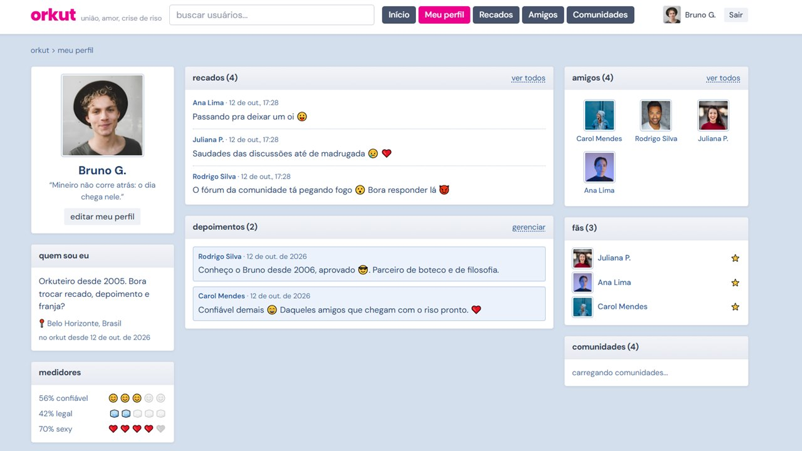
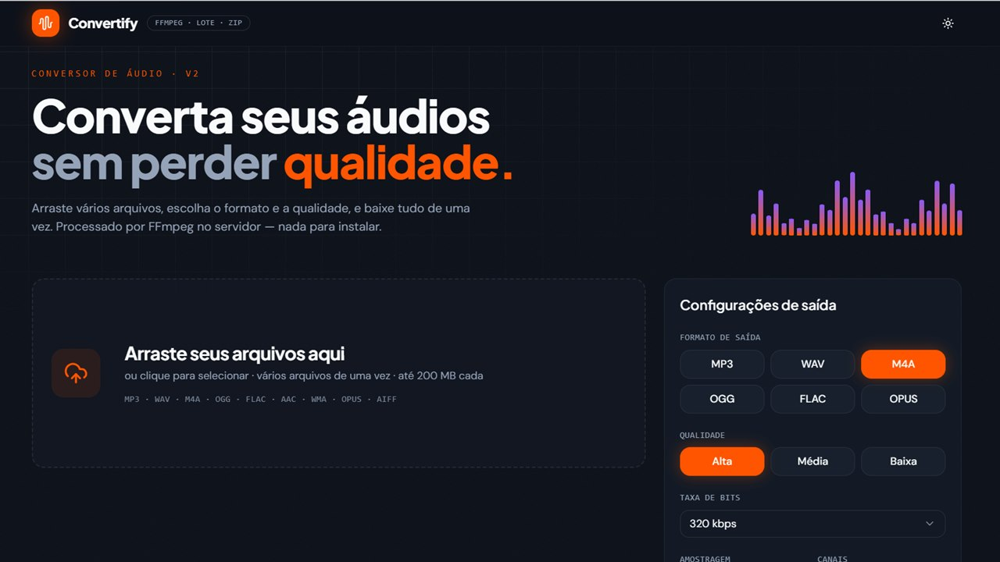
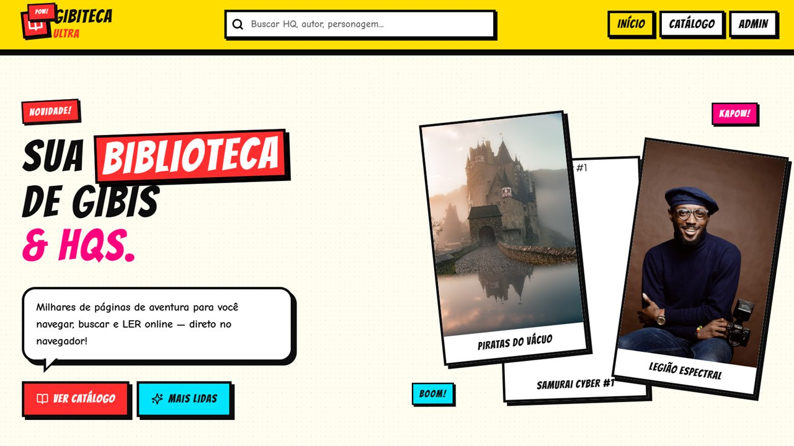
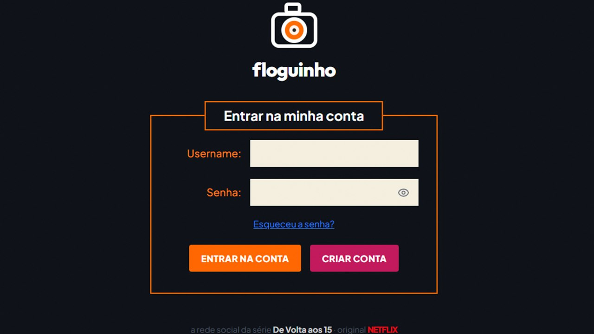

<div align="center">


<a href="https://github.com/kauan-meirelles">
  
</a>

<br/><br/>

<a href="https://www.linkedin.com/in/SEU-USUARIO"></a>
<a href="mailto:SEU-EMAIL@exemplo.com"></a>
<a href="https://SEU-PORTFOLIO.dev"></a>


</div>

<br/>

## 👨‍💻 Sobre mim

```java
public class Kauan {
    String papel     = "Desenvolvedor Full-Stack";
    String foco      = "Java, Spring Boot, APIs REST";
    String estudando = "POO avançada, estruturas de dados, algoritmos";
    boolean aberto   = true; // estágio / vaga júnior
}
```

| | |
|---|---|
| 🔭 **Agora** | Construindo o [`Convertify`](https://github.com/kauan-meirelles/convertify), um conversor de áudio full-stack |
| 🌱 **Aprendendo** | Spring Security, testes com JUnit, Docker |
| 🤝 **Procuro** | Estágio ou vaga júnior em Full-stack |
| 💬 **Pergunte sobre** | Java, Spring, MySQL, Git |

<br/>

## 🛠️ Stack

<div align="center">

**Linguagens**<br/>


**Back-end e dados**<br/>


**Ferramentas**<br/>


</div>

<br/>

## 🎯 Foco atual

<div align="center">

| Meta | Progresso |
|---|---|
| Java avançado e POO |  |
| Spring Boot e APIs REST |  |
| Estruturas de dados |  |
| Docker e deploy |  |

</div>

<br/>

## 📌 Projetos em destaque

<table>
  <tr>
    <td width="50%" valign="top">
      <a href="https://github.com/kauan-meirelles/orkut"></a>
      <h3><a href="https://github.com/kauan-meirelles/orkut">🩷 orkut clássico</a></h3>
      Recriação nostálgica do Orkut com recados, depoimentos que precisam de aprovação, comunidades com fórum, fãs e os medidores de confiável, legal e sexy.
      <br/><br/>
      <code>React</code> <code>TypeScript</code> <code>FastAPI</code> <code>MongoDB</code> <code>JWT</code>
    </td>
    <td width="50%" valign="top">
      <a href="https://github.com/kauan-meirelles/convertify"></a>
      <h3><a href="https://github.com/kauan-meirelles/convertify">🎧 Convertify</a></h3>
      Conversor de áudio em lote: arraste vários arquivos, escolha formato e qualidade, acompanhe o progresso em tempo real e baixe tudo em ZIP. Conversão com FFmpeg no servidor.
      <br/><br/>
      <code>React</code> <code>Tailwind</code> <code>FastAPI</code> <code>FFmpeg</code> <code>MongoDB</code>
    </td>
  </tr>
  <tr>
    <td width="50%" valign="top">
      <a href="https://github.com/kauan-meirelles/gibiteca-ultra"></a>
      <h3><a href="https://github.com/kauan-meirelles/gibiteca-ultra">💥 Gibiteca Ultra</a></h3>
      Biblioteca e leitor de HQs com visual pop-art: busca, filtros por editora, gênero e ano, e leitor com zoom, tela cheia e atalhos de teclado.
      <br/><br/>
      <code>React</code> <code>Tailwind</code> <code>FastAPI</code> <code>MongoDB</code>
    </td>
    <td width="50%" valign="top">
      <a href="https://github.com/kauan-meirelles/floguinho"></a>
      <h3><a href="https://github.com/kauan-meirelles/floguinho">📸 Floguinho</a></h3>
      A rede social de fotos da série <i>De Volta aos 15</i> (Netflix): feed com filtros retrô, recados, "virar fã" e mensagens privadas entre os flogs.
      <br/><br/>
      <code>React</code> <code>TypeScript</code> <code>FastAPI</code> <code>MongoDB</code>
    </td>
  </tr>
</table>

<details>
<summary><b>Mais projetos</b></summary>

<br/>

| Projeto | Sobre | Stack |
|---|---|---|
| 🐺 [**QG Jão**](https://github.com/kauan-meirelles/qgjao) | Rede social de fãs do Jão, com feed, fórum, chat por canais, ranking de fãs e legendas geradas por IA | `React` `TypeScript` `FastAPI` `MongoDB` `OpenAI` |
| 🐾 [**Instituto Vida Animal**](https://github.com/kauan-meirelles/clinica-veterinaria) | Site de clínica veterinária com agendamento online e painel administrativo | `React` `TypeScript` `FastAPI` `MongoDB` |

</details>

<br/>

## 📊 Atividade no GitHub

<div align="center">

<picture>
  <source media="(prefers-color-scheme: dark)" srcset="https://github-readme-streak-stats.herokuapp.com?user=kauan-meirelles&theme=github-dark&hide_border=true" />
  
</picture>

<picture>
  <source media="(prefers-color-scheme: dark)" srcset="https://github-readme-stats.vercel.app/api/top-langs/?username=kauan-meirelles&layout=donut&theme=github_dark&hide_border=true" />
  
</picture>


<picture>
  <source media="(prefers-color-scheme: dark)" srcset="https://raw.githubusercontent.com/kauan-meirelles/kauan-meirelles/output/github-snake-dark.svg" />
  
</picture>

</div>

<br/>

## 🤝 Vamos conversar?

Se quiser trocar uma ideia, tirar dúvidas ou falar sobre oportunidades, me chame no LinkedIn ou por e-mail.

<div align="center">

_"Acredito no poder do código como ferramenta de transformação."_


</div>

<!--
Para a animação Snake funcionar, crie .github/workflows/snake.yml usando a action Platane/snk
e rode o workflow uma vez. Troque também todos os textos em MAIÚSCULAS.
-->
